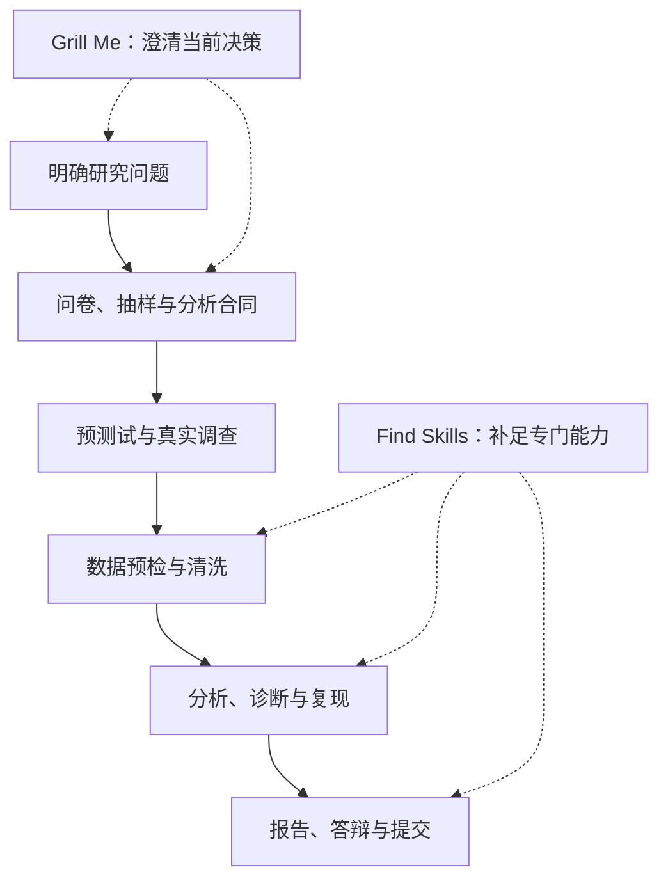

<div align="center">

# 正大杯研策 · Zhengda Research Copilot

**从研究问题到可复核成果，为市场调查竞赛团队组织完整的研究过程。**

Research Design · Survey Analytics · Reproducible Workflows

[](https://github.com/zhulehan683-commits/zhengda-research-copilot/actions/workflows/tests.yml)
[](docs/VALIDATION.md)
[](docs/INSTALLATION.md)
[](SKILL.md)

[快速开始](#快速开始) · [研究能力](#研究能力) · [十三阶段](#十三阶段研究流程) · [核心机制](#核心机制) · [交付资产](#交付资产与质量闭环)

[Grill Me](#grill-me先把研究方案问清楚) · [Find Skills](#find-skills按具体任务补足能力) · [命令速查](#命令速查) · [安装与适配](#安装与适配) · [验证](#验证与边界) · [文档导航](#文档导航)

</div>

---

## 项目概览

**正大杯研策**是面向「正大杯」全国大学生市场调查与分析大赛的中文优先 Agent Skill。它将研究方法指引、工作模板、本地审核脚本和多 Agent 交接协议组织在同一套项目结构中，帮助团队明确当前阶段、形成研究设计、保留数据与分析依据，并把结果接入报告和答辩。

项目适合三类使用方式：从零筹备比赛、接续已有研究、只处理一个明确任务。无论从哪一阶段开始，核心目标都是让研究问题、调查工具、分析结果和最终主张之间有清晰的对应关系。

| 设计重点 | 在项目中的体现 |
| --- | --- |
| 研究问题驱动 | 从研究对象、可观测变量和数据可达性出发，选择问卷与分析方法 |
| 按阶段交付 | 13 阶段分别维护输入、产物、证据与复核要求，支持接续工作 |
| 关键决定可追溯 | 通过分析合同、依赖清单、来源登记和文件哈希保留研究依据 |
| 按需增强能力 | Grill Me 澄清研究决策，Find Skills 发现任务所需的专门工具 |
| 跨 Agent 复用 | 主入口、参考资料、模板和 Python 工具共用一套内容 |

默认规则包为**第十七届正大杯（2026—2027）**。其中赛程与规则作为基线使用，具体要求以本人适用的当届主办方、赛区和学校通知为准。项目当前为 **Preview**，非主办方官方产品；真实调查、研究判断和正式提交由参赛团队完成。

## 快速开始

### 1. 准备环境

| 使用方式 | 需要的环境 |
| --- | --- |
| 让 Agent 读取研究指引与模板 | 支持 `SKILL.md` 或能显式读取本地文件的 Agent |
| 使用 Skills CLI 联网安装 | Node.js/npm、Git、网络连接 |
| 运行状态、预检与交接脚本 | Python 3.10+，仅依赖标准库 |
| 执行统计计算、导出 Word/PPT | 另行准备对应软件、库或外部技能，按实际任务选用 |

### 2. 安装主技能

以 Codex 全局安装为例：

```sh
npx skills add zhulehan683-commits/zhengda-research-copilot --skill zhengda-research-copilot -g -a codex -y
```

使用其他 Agent 时替换 `-a codex`；去掉 `-g` 可安装到当前项目。多执行端安装、离线包和 Windows D 盘主副本见[安装与适配](#安装与适配)。

### 3. 发出第一个研究请求

新开会话或刷新技能列表后输入：

```text
使用 $zhengda-research-copilot。

我准备正大杯，目前只有初步方向，还没有真实调查数据。
本轮先比较三个可执行选题：
说明研究对象、研究问题、数据渠道、成本、风险和淘汰理由。

先读取已有材料；缺少的事实标注待核验。
不要生成调查结果，也不要把计划中的数字写成实测结果。
```

首轮应得到选题与可行性比较、材料缺口及下一步设计工作。仅咨询或讨论时无需先建立项目；需要保存研究产物和状态时，再提供独立研究目录。

其他 Agent 可使用自然语言“使用正大杯研策 skill”，或按其支持的调用语法指定 `zhengda-research-copilot`。更多启动模板见 [CODEX_START.md](CODEX_START.md)。

<details>
<summary><strong>先查看内容，或临时试用而不安装</strong></summary>

```sh
npx skills add zhulehan683-commits/zhengda-research-copilot --list
npx skills use zhulehan683-commits/zhengda-research-copilot --skill zhengda-research-copilot
```

`--list` 查看可发现的技能。`use` 下载资源并打印入口提示词，不启动模型，也不代表客户端已原生加载。

</details>

## 研究能力

项目以任务产物为组织单位。已有材料越明确，Agent 越能直接进入对应工作，无需从报名阶段重新开始。

| 研究任务 | 主要工作 | 代表性产物 |
| --- | --- | --- |
| 赛事准备 | 适用通知核验、知识赛学习、队伍资格与分工 | [规则核验表](templates/rules-checklist.md)、[学习计划](templates/knowledge-exam-study-plan.md)、[团队名册](templates/team-roster.csv) |
| 选题与可行性 | 比较研究价值、样本可达性、资源与风险，保留淘汰理由 | [研究简报](templates/research-brief.md)、[选题评分表](templates/topic-scorecard.csv) |
| 文献与市场研究 | 登记政策、文献、行业数据及其口径，区分事实、推论与假设 | [来源登记表](templates/source_register.csv)、[研究设计](references/research-design.md)、[市场研究](references/market-research.md) |
| 问卷与抽样设计 | 建立构念、题项、编码和分析方法映射，检查时间窗、选项、跳题与抽样限制 | [问卷蓝图](templates/questionnaire-blueprint.csv)、[逐题审核表](templates/questionnaire-review.csv)、[抽样计划](templates/sampling-plan.md) |
| 预测试与调查实施 | 记录真实预测试、问卷修订、调查渠道与数据来源 | [预测试日志](templates/pilot-log.md)、[调查记录](templates/fieldwork-log.csv) |
| 数据预检与清洗 | 核对 CSV 合同，记录缺失、重复、编码与排除决策 | [预检合同](templates/data-preflight-schema.json)、[变量字典](templates/data-dictionary.csv)、[清洗报告](templates/cleaning-report.md) |
| 统计分析与复现 | 根据问题和数据选择方法，明确前提、诊断、稳健性与失败降级 | [分析计划](templates/analysis-plan.md)、[方法路由](references/method-routing.md)、[测量与推断](references/measurement-and-inference.md) |
| 报告、图表与答辩 | 绑定研究问题与结果，检查图表口径，组织正文、讲稿与模拟问答 | [结果矩阵](templates/result-matrix.csv)、[图表登记表](templates/figure-register.csv)、[答辩问题库](templates/defense-question-bank.md) |

统计模型由实际可用的 Python/R/SPSS/AMOS/MATLAB 等工具执行，相关软件和扩展库不随技能安装。只有具备真实、相关、合规文本时才启用[文本分析](references/text-analysis.md)；词云本身不能代替研究结论。

## 十三阶段研究流程

完整研究按以下阶段组织。表中的产物是工作方向，正式放行所需证据键与复核条件以[阶段地图](references/stages.md)和[质量门禁](references/gates.md)为准。

| 阶段 | 标识 | 核心目标 | 主要产物或记录 |
| --- | --- | --- | --- |
| 01 · 报名核验 | `registration` | 确认届次、组别、适用通知与本人报名状态 | 规则核验、报名确认 |
| 02 · 知识赛准备 | `knowledge` | 复习调查与统计知识，记录本人考试情况 | 学习计划、真实考试结果 |
| 03 · 组队与分工 | `team` | 核对成员资格、职责与能力配置 | 团队名册与分工 |
| 04 · 选题比较 | `topic` | 确定可调查、可回答、可实施的研究问题 | 研究简报、可行性说明 |
| 05 · 文献与二手研究 | `desk_research` | 建立来源依据、研究缺口与变量框架 | 来源登记、研究缺口 |
| 06 · 调查设计 | `design` | 确定问卷、抽样、测量与分析安排 | 调查工具、抽样计划、设计清单 |
| 07 · 预测试 | `pilot` | 用真实测试发现理解、流程与实施问题 | 预测试日志、修订记录 |
| 08 · 正式调查 | `fieldwork` | 实施调查，保留原始数据与来源过程 | 调查日志、私有原始数据 |
| 09 · 数据清洗 | `cleaning` | 按明确规则处理数据并保留变动依据 | 清洗代码、分析数据、清洗报告 |
| 10 · 统计分析 | `analysis` | 回答研究问题，完成诊断与复现 | 分析代码、结果表、诊断报告、分析清单 |
| 11 · 研究报告 | `report` | 连接结论、证据、限制与行动建议 | 报告、结论证据表、AI 使用记录 |
| 12 · 答辩准备 | `defense` | 将已核验研究转化为清晰的展示与回应 | PPT、讲稿、模拟答辩记录 |
| 13 · 提交审核 | `submission` | 核对当届要求并记录团队正式提交 | 提交清单、真实回执 |

单阶段咨询、草稿和计划可以独立完成；正式阶段 `passed` 仍要求前序证据和实际复核。已有项目通过读取状态继续，不重新初始化或补造历史通过记录。

### 研究、决策与工具如何衔接



Grill Me 与 Find Skills 是按需入口。研究问题已经明确时直接推进当前工作；缺少专门工具时，再发现和接入外部能力。

## Grill Me：先把研究方案问清楚

Grill Me 用于压力测试选题、抽样、问卷或分析决定。项目整合了 [Matt Pocock 的 grill-me / grilling](https://github.com/mattpocock/skills/tree/49dd158d1076134a641b33efb035946536778336/skills/productivity)：上游 `grill-me` 是入口，`grilling` 提供分轮访谈方法；本项目提供可直接执行的研究适配版。

它先读取已有材料，区分已知事实、用户已作决定、待查事实和待作决定，再按依赖关系提问。同一轮只覆盖前置条件已确定的问题，每问附建议与理由，收到用户答复后再展开依赖问题。

```text
使用正大杯研策，grill me。

我们想研究大学生对校园二手交易平台的使用。
本轮只讨论研究问题与样本可达性。
每轮给出建议和理由，等我回答后再展开依赖问题。
已能从材料查到的事实请自行核对。
```

例如，研究对象尚未确定时，先澄清对象、研究目的和可接触渠道，再讨论样本分配、量表或模型。需要真实预测试才能回答的事项留作待验证，不能靠反复提问替代实证。

完成本轮讨论时，交付一段完整研究说明，以及已决定事项、待核验事实和剩余风险；经用户确认后接入研究简报、抽样计划或分析合同。纯讨论不自动创建研究项目或批准阶段，明确的执行任务也不必先访谈。

详见[研究压力测试指南](references/grill-me.md)。

## Find Skills：按具体任务补足能力

Find Skills 用于发现当前工作真正缺少的专门能力，例如文献核验、统计诊断、DOCX 报告导出或答辩材料制作。项目整合了 [Vercel 的 find-skills](https://github.com/vercel-labs/skills/blob/13e4063a1cf913f5606d57d42ab83a86f5001e04/skills/find-skills/SKILL.md)，并增加研究语境、项目级安装和离线处理规则。

```text
使用正大杯研策的 Find Skills。

我们的报告需要导出 DOCX，并检查图表与正文排版。
先检查当前已安装技能；不足时再查 GitHub 和 skills.sh。
推荐最少必要的候选，说明用途、输入输出、依赖、
来源提交、许可证、数据去向和未验证点。
```

| 环节 | 需要确认的事项 |
| --- | --- |
| 明确缺口 | 需要哪种产物，现有工具为什么不足 |
| 优先本地 | 当前会话实际发现了哪些可用技能和工具 |
| 搜索生态 | 通过 [skills.sh](https://skills.sh)、`npx skills find` 或 GitHub 获取候选 |
| 审查内容 | 打开 SKILL.md、依赖与脚本，核对方法前提、格式与数据处理方式 |
| 安装与试用 | 按用户已授权范围操作，默认项目级，记录尚未执行的步骤 |
| 接回研究 | 检查真实产物，把结果纳入本项目的证据和复核流程 |

安装数与 stars 仅作发现线索。离线时明确说明未查询远端，优先继续可完成的本地工作；回忆中的候选标为未验证。外部技能不会自动改变研究总体、原始数据或项目权威状态。

详见[技能发现指南](references/find-skills.md)与[集成说明](references/integrations.md)。

## 核心机制

### 设计合同与计算依赖

研究方案和分析结果需要分别记录依据：

| 机制 | 记录内容 | 对应模板 |
| --- | --- | --- |
| 分析合同 | 变量与估计量、主要分析、排除规则、诊断与稳健性安排 | [analysis-contract.csv](templates/analysis-contract.csv) |
| 设计清单 | 问卷、变量字典和分析合同等实际依赖文件及 SHA-256 | [design-manifest.json](templates/design-manifest.json) |
| 分析清单 | 实际输入、代码、配置、结果、复现命令与环境说明 | [analysis-manifest.json](templates/analysis-manifest.json) |
| 结论证据映射 | 每项主张对应的数据、代码、表图、来源与限制 | [claim-evidence-matrix.csv](templates/claim-evidence-matrix.csv) |

清单模板中的示例路径和占位哈希必须替换为真实项目内容，并通过 `evidence add` 登记。依赖文件变化后，旧验收会失效；清单仍需由团队列全，脚本不自动扫描所有计算依赖。

### 机械门禁与独立复核

`workflow.py` 管理项目状态、证据登记、阶段检查与复核记录。其机械检查关注文件、路径、哈希、清单和前序条件；研究方法是否合理、调查是否真实、结论是否越界，仍需要专业判断。

因此，文件存在、门禁通过、复核记录和研究质量是不同层次。复核者署名用于留痕，脚本不认证其真实身份或审查质量。七维评分用于汇总选题、文献、设计、调查、分析、报告与创新方面的意见，不代替阶段放行。

### CSV 数据合同预检

`survey_audit.py` 根据真实变量字典对应的 schema 检查必填缺失、类型、数值范围、离散允许值、重复标识和 CSV 列结构。输出保留汇总诊断与输入哈希，原始文件保持不变。

Schema 对未知字段和未实现约束采用严格拒绝方式，避免“写了规则但实际未检查”。预检不自动剔除样本、不计算信效度或显著性，`READY_FOR_REVIEW` 只表示可进入人工复核。

### 多 Agent 交接

研究设计、分析实现、报告写作和独立复核可以按实际工具条件分工。团队通过 `task_queue.py` 保存输入快照、验收条款、执行记录、输出哈希和签收意见。

| 情况 | 有效状态提示 | 处理方向 |
| --- | --- | --- |
| 任务输入已变化 | `STALE_INPUT` | 重新确认输入并创建或明确更新任务 |
| 验收条款已变化 | `STALE_ACCEPTANCE` | 重新核对交付要求 |
| 提交产物已变化 | `STALE_OUTPUT` | 重新验收修改后的输出 |
| 执行日志已变化 | `STALE_EXECUTION` | 核对实际运行记录后再签收 |

任务 `accepted` 与阶段 `passed` 分别管理。权威项目状态由单一协调者写入，执行端在隔离目录产出；本地队列负责登记交接，实际 Agent 调用由外部编排器完成。

详见[Agent 协作协议](references/agents.md)与[角色及复核指南](references/roles-and-review.md)。

## 典型使用场景

### 审核现有问卷

```text
使用正大杯研策，读取我提供的问卷与变量字典。
按构念、时间窗、措辞、选项、跳题、编码和分析用途逐题审核。
区分必须修改、建议优化和需要预测试的问题，
输出逐题审核表及分析合同草稿，不替我补造预测试结果。
```

建议交付：问题定位、修改理由、变量与题项映射、待实测事项。可配合[问卷与抽样指南](references/survey-quality.md)使用。

### 从真实数据进入分析

```text
使用正大杯研策，接续已有项目。
先读取研究问题、抽样说明、变量字典和分析合同，
检查 CSV 数据合同，再比较适用的最小可行分析方案。
列明方法前提、诊断、失败降级、复现命令和结论范围。
```

建议交付：预检诊断、方法选择依据、代码与结果、限制说明。分析过程中记录的结果应能与实际运行产物对应；模板数字和模拟夹具不可充作调查结果。

### 由已核验报告准备答辩

```text
使用正大杯研策，只处理答辩阶段。
读取已核验报告与图表，给出展示结构、逐页证据、
讲稿要点以及可能被追问的方法和局限。
报告没有支持的内容标注待补，不添加新调查结论。
```

建议交付：PPT 结构或实际可用工具生成的文件、讲稿、模拟问答和待修订项。报告生产要求见[报告指南](references/report-production.md)，答辩组织见[报告与答辩](references/report-defense.md)。

## 交付资产与质量闭环

项目把研究交付分成**决策资产、证据资产和展示资产**。决策资产先定义“要回答什么、怎么测量、如何分析”；证据资产保留“数据从哪里来、规则如何执行、结果如何产生”；展示资产只从已核验证据生成。这个分层让团队在赶进度时也能分清哪些内容可以草拟，哪些内容必须核实。

| 资产层 | 目标 | 代表模板 | 完成标志 |
| --- | --- | --- | --- |
| 决策资产 | 明确研究问题、构念、样本和建模路线 | [research-brief.md](templates/research-brief.md)、[questionnaire-blueprint.csv](templates/questionnaire-blueprint.csv)、[analysis-contract.csv](templates/analysis-contract.csv) | 研究问题、变量、样本与方法可对应 |
| 证据资产 | 登记来源、过程、清洗与计算依据 | [source_register.csv](templates/source_register.csv)、[pilot-log.md](templates/pilot-log.md)、[cleaning-report.md](templates/cleaning-report.md)、[analysis-manifest.json](templates/analysis-manifest.json) | 输入、规则、代码、结果和环境可追溯 |
| 展示资产 | 把已核验结论转化为报告与答辩材料 | [result-matrix.csv](templates/result-matrix.csv)、[figure-register.csv](templates/figure-register.csv)、[defense-question-bank.md](templates/defense-question-bank.md) | 每个核心主张都有表图或结果支撑 |

质量闭环按四步运转：**登记 → 机械检查 → 独立复核 → 变更失效**。文件先通过 `evidence add` 登记哈希；`workflow.py gate` 检查证据和前序条件；复核者记录独立意见；输入或规则变化后，下游通过状态自动失效。这个机制不保证研究一定优秀，但能防止旧证据、旧承诺和新报告混在一起。

项目同时保留三类记录，便于赛前自查和赛后复盘：

| 记录 | 用途 | 入口 |
| --- | --- | --- |
| AI 使用记录 | 说明模型辅助、人工核验和最终责任 | [ai-usage-log.csv](templates/ai-usage-log.csv) |
| 选题淘汰记录 | 保留被放弃方案的理由，避免后期重复试错 | [topic-scorecard.csv](templates/topic-scorecard.csv) |
| 风险与限制 | 登记样本、测量、外部性和规则不确定性 | [research-brief.md](templates/research-brief.md)、[gates.md](references/gates.md) |

写作和展示时遵循一条固定链路：**研究问题 → 数据与样本 → 方法与前提 → 结果与诊断 → 结论边界 → 行动建议**。缺少任何一环时，先在结果矩阵中标注“待补”或“限制”，不要把展示语言当作证据补齐。

## 命令速查

以下命令假设研究目录已赋值给 `$project`，并且从主技能根目录或使用脚本绝对路径运行。命令只做登记、检查和预检，不自动执行现实调查，也不自动批准阶段。

| 场景 | 命令 | 结果判断 |
| --- | --- | --- |
| 新建研究项目 | `python scripts/workflow.py init --project $project --competition zhengda-17 --season 2026-2027` | 创建 13 阶段状态；已有项目会被拒绝覆盖 |
| 查看阶段状态 | `python scripts/workflow.py status --project $project` | 输出各阶段状态、证据与待办门禁 |
| 登记证据文件 | `python scripts/workflow.py evidence add --project $project --stage <阶段> --key <证据键> --file <项目内文件>` | 记录文件路径与哈希；脚本拒绝项目外和符号链接路径 |
| 检查阶段门禁 | `python scripts/workflow.py gate --project $project --stage <阶段>` | `0` 表示机械检查通过，`3` 表示阻断，`2` 表示输入错误 |
| 记录独立复核 | `python scripts/workflow.py review --project $project --stage <阶段> --reviewer <复核者> --decision pass --note <意见>` | 复核记录用于留痕；通过与放行仍需协调者核实 |
| 预检 CSV 合同 | `python scripts/survey_audit.py --project $project --data raw_private/survey.csv --schema plans/data-schema.json --output analysis/data-preflight-01.json` | `0` 表示可人工复核，`3` 表示合同问题 |
| 创建/提交交接任务 | `python scripts/task_queue.py --help` | 状态含 `STALE_*` 时先核对输入、验收或输出变化 |
| 汇总七维复核 | `python scripts/score_review.py --help` | 评分只汇总意见，不替代门禁与研究判断 |

首次使用时优先执行 `status` 而不是重新初始化；升级或迁移安装副本后，先运行 `python install.py --verify`，再在研究目录执行 `status` 确认旧状态可读。更多错误码、路径规则和故障恢复见[安装指南](docs/INSTALLATION.md)。

## 安装与适配

### 联网安装：同一主技能，多执行端使用

Skills CLI 可重复指定 `-a`。以下为示例，只保留实际使用的 Agent：

```sh
npx skills add zhulehan683-commits/zhengda-research-copilot --skill zhengda-research-copilot -g -a codex -a claude-code -a codebuddy -a hermes-agent -y
```

| Agent / 执行端 | Skills CLI 标识 | 常见技能根目录或接入方式 |
| --- | --- | --- |
| Codex | `codex` | `~/.agents/skills` |
| Claude Code | `claude-code` | `~/.claude/skills`，可能受配置目录影响 |
| CodeBuddy / WorkBuddy | `codebuddy` | `~/.codebuddy/skills`，以实际产品配置为准 |
| Hermes Agent | `hermes-agent` | `~/.hermes/skills`，可受 `HERMES_HOME` 影响 |
| DSH / 其他 Harness | 按实际发现能力配置 | 可由主控显式提供技能入口和本轮参考资料 |

路径可写、技能被发现、脚本能运行和模型完成任务分别验证；表中路径不构成所有产品版本的运行保证。更多 Agent、项目级目录及配置差异见[安装指南](docs/INSTALLATION.md)。

### 离线安装与 D 盘主副本

clone 或完整 ZIP 解压后，在仓库根目录运行。离线安装器本身不需要联网：

```sh
git clone https://github.com/zhulehan683-commits/zhengda-research-copilot.git
cd zhengda-research-copilot
python install.py --dry-run
python install.py
python install.py --verify
```

默认主副本为 `~/.agents/skills/zhengda-research-copilot`。Windows 可将其放在 D 盘，再链接到执行端实际使用的技能根目录：

```powershell
python install.py --target-root D:\AgentSkills --agent-root "$HOME\.agents\skills" --agent-root "$HOME\.codebuddy\skills"
python install.py --target-root D:\AgentSkills --agent-root "$HOME\.agents\skills" --agent-root "$HOME\.codebuddy\skills" --verify
```

| 安装事项 | 当前行为 |
| --- | --- |
| 已有目标 | 默认拒绝覆盖；核对后使用 `--force` 升级，旧版保留备份 |
| 共享主副本 | Windows 使用 Junction，POSIX 使用符号链接 |
| 无法建立链接 | 使用 `--mode copy`，后续升级重新同步各副本 |
| 安装内容 | 主技能、参考资料、模板、运行脚本、适配入口与上游许可 |
| 不随最小包复制 | Git 历史、测试目录、Python 缓存和原始调查数据 |
| 校验范围 | 安装 manifest 与文件哈希，不等于模型或客户端运行认证 |

同一安装副本选择 Skills CLI 或离线安装器之一维护。ZIP、更新、失败恢复及旧标识迁移见[安装指南](docs/INSTALLATION.md)；Windows `install.ps1` 使用同一 Python 安装逻辑。

### 子技能如何随包使用

| 位置 | 用途 |
| --- | --- |
| `.agents/skills/{grill-me,grilling,find-skills}/SKILL.md` | 可直接执行的研究适配入口，包含范围限制与回退规则 |
| `references/grill-me.md`、`references/find-skills.md` | 主技能调用时的研究语境、示例与交接说明 |
| `references/upstream-skills/` | 固定版本的完整上游原文，用于来源对照 |
| `licenses/`、`docs/upstreams.lock.json` | 完整许可、来源提交、原文副本与目标路径记录 |

适配入口和原文都随离线主包携带；主技能可以直接读取适配入口，不要求原生 Skill 调用工具。客户端是否独立发现子技能取决于扫描行为；若出现同名原文与适配入口，应通过主技能和明确文件路径选择研究适配版。随包文件不会自动额外注册成三个全局技能。

详见[技能整合记录](docs/SKILL_INTEGRATION.md)。

## 用本地工具核对真实材料

以下命令从主技能根目录执行；从其他目录运行时使用脚本绝对路径。研究工作区应与技能安装目录分开。

### 初始化与接续

```powershell
$project = 'D:\Competitions\MySurvey'
python scripts/workflow.py init --project $project
python scripts/workflow.py status --project $project
```

初始化会建立研究目录和 13 阶段状态。`init` 拒绝覆盖已有项目，恢复时直接执行 `status`。当前脚本内置 `zhengda-17 / 2026-2027` 配置；其他赛事或届次需要先加入经过核验的配置。

工作区按职责分开：`sources/` 保存来源材料，`plans/` 保存研究设计，`raw_private/` 保存私有原始数据，`data/` 与 `analysis/` 保存分析数据和产物，`report/`、`defense/` 保存交付材料，`state/` 与 `tasks/` 保存状态和交接记录。

### CSV 预检

1. 将获准的原始 CSV 放入研究工作区 `raw_private/`。
2. 按真实变量字典修改[预检合同模板](templates/data-preflight-schema.json)，保存为 `plans/data-schema.json`。
3. 执行预检，选择尚不存在的输出文件名：

```powershell
python scripts/survey_audit.py --project $project --data raw_private/survey.csv --schema plans/data-schema.json --output analysis/data-preflight-01.json
```

| 退出码 | 含义 | 后续动作 |
| --- | --- | --- |
| `0` | `READY_FOR_REVIEW` | 进入人工复核，继续检查样本、测量和分析条件 |
| `3` | `BLOCKED` | 处理数据合同问题，解释或修正后重新预检 |
| `2` | 输入或执行错误 | 核对路径、schema、编码和输出文件是否已存在 |

输出只在 `analysis/` 内新建。重复运行使用新的文件名，原始数据和已有诊断不会被覆盖。

### 命令导航

| 需求 | 入口 |
| --- | --- |
| 查看项目状态 | `python scripts/workflow.py status --project <研究目录>` |
| 证据登记、阶段检查与复核 | `python scripts/workflow.py --help`、[质量门禁](references/gates.md) |
| 输入快照、执行回执与任务签收 | `python scripts/task_queue.py --help`、[协作协议](references/agents.md) |
| CSV 预检参数 | `python scripts/survey_audit.py --help` |
| 七维评分汇总 | `python scripts/score_review.py --help`、[角色与复核](references/roles-and-review.md) |
| 选择研究模板 | [模板索引](templates/README.md) |

`workflow.py gate` / `review` 的阻断或复核不通过返回 `3`，输入错误返回 `2`。签收任务时检查真实文件和验收记录，而不仅是进程是否启动或退出。

## 项目结构

```text
zhengda-research-copilot/
|-- SKILL.md                     主技能入口与任务路由
|-- CODEX_START.md               跨 Agent 启动提示词
|-- .agents/skills/              Grill Me、grilling、Find Skills 适配入口
|-- agents/openai.yaml           可选界面元数据
|-- competitions/zhengda-17/     第十七届赛事规则基线
|-- references/                 阶段、研究方法、交付与协作指南
|   |-- upstream-skills/        固定上游原文
|   |-- grill-me.md             研究决策压力测试
|   `-- find-skills.md          外部能力发现
|-- templates/                  研究与交付模板
|-- scripts/                    状态、预检、任务交接与评分工具
|-- docs/                       安装、验证、来源与项目说明
|-- licenses/                   上游完整许可
|-- tests/                      源码回归测试
|-- .github/workflows/          Windows / Linux CI
`-- install.py / install.ps1    统一离线安装入口
```

## 验证与边界

### 当前验证覆盖

源码 CI 配置覆盖 Windows/Linux 与 Python 3.10—3.13，检查单元测试、命令入口、离线安装与适配副本。当前运行结果以顶部 [Tests](https://github.com/zhulehan683-commits/zhengda-research-copilot/actions/workflows/tests.yml) 为准。

| 验证层次 | 已有检查 | 结论范围 |
| --- | --- | --- |
| 指令与资源 | 主技能及适配入口格式、相对路径、上游原文与许可哈希 | 说明文件和资源关系可核对 |
| 本地工具 | 状态、证据失效、任务交接、CSV、评分和安装回归测试 | 实现行为符合对应测试用例 |
| 安装副本 | 主副本与适配目标的 manifest / SHA-256 校验 | 文件与安装记录一致 |
| 有限模型场景 | 经 Magpie 进行独立审计、研究入口文本场景模拟 | 仅覆盖记录中的输入和环境 |
| 客户端运行 | 按产品分别确认发现、脚本和模型任务 | 不能由文件校验推定全部客户端已加载 |

最近一次整合的维护者记录包含 **68 项本地测试：67 通过、1 项因 Windows 符号链接权限跳过**，以及主副本和 CodeBuddy 目标各 **86 个文件**校验。它们是具体版本与环境下的记录，最新内容和限制见[验证记录](docs/VALIDATION.md)。

在**完整源码仓库**根目录可运行：

```sh
python -m unittest discover -s tests -p "test_*.py" -v
```

最小安装包不包含 `tests/`。文件安装、客户端发现、脚本执行和模型完成任务分别验证；目前未验证真实参赛项目从调查到正式提交的无人值守全流程。

### 研究使用原则

- **数据真实**：无真实数据时交付研究设计、代码框架或待填结果表；模拟数据仅用于明确标注的测试。
- **推断有界**：便利样本的结论先限定于本次受访样本，扩大样本或 bootstrap 不自动赋予总体代表性。
- **证据可核对**：哈希、预检与评分辅助复核，不证明调查真实、统计正确或评审独立。
- **规则适用**：报名代码、校赛时间、提交格式与 AI 使用要求应核对本人适用通知。
- **信息受保护**：受访者标识与敏感数据留在私有工作区，外部处理前完成授权与脱敏。

## 文档导航

| 你想了解什么 | 文档 |
| --- | --- |
| 首次调用与会话输入 | [启动模板](CODEX_START.md) |
| 安装、更新、迁移与多 Agent 路径 | [安装指南](docs/INSTALLATION.md) |
| 各阶段要交什么材料 | [阶段地图](references/stages.md)、[质量门禁](references/gates.md) |
| 问卷、抽样与测量 | [问卷与抽样](references/survey-quality.md)、[测量与推断](references/measurement-and-inference.md) |
| 分析方法与复现 | [方法路由](references/method-routing.md)、[统计复现](references/analysis.md)、[方案比较模板](templates/model-option-comparison.md) |
| 报告、图表与答辩 | [可视化](references/visualization-guide.md)、[报告生产](references/report-production.md)、[报告与答辩](references/report-defense.md) |
| 模板选择与填写 | [模板索引](templates/README.md) |
| 技能来源、原文与适配差异 | [整合记录](docs/SKILL_INTEGRATION.md)、[第三方声明](THIRD_PARTY_NOTICES.md)、[来源锁文件](docs/upstreams.lock.json) |
| 实际验证范围与已知限制 | [验证记录](docs/VALIDATION.md) |
| 项目范围与变更 | [项目说明](docs/PROJECT_SPEC.md)、[更新记录](CHANGELOG.md) |

## 来源、许可与贡献

### 上游来源与项目适配

| 来源 | 已整合内容 | 本项目处理 |
| --- | --- | --- |
| [mattpocock/skills](https://github.com/mattpocock/skills) | `grill-me` / `grilling` 原文与分轮提问方法 | 固定原文，提供面向研究决策的自含适配入口 |
| [vercel-labs/skills](https://github.com/vercel-labs/skills) | `find-skills` 原文与生态发现方法 | 增加本地优先、离线降级、项目级安装和来源核验 |
| [zhengdabei-survey-report-skill](https://github.com/DDXYY189/zhengdabei-survey-report-skill) | 方法路由、文本、图表、报告契约与模板 | 映射到本项目 13 阶段和证据链 |
| [mathmodel-skill](https://github.com/rootkiller6788/mathmodel-skill) | 角色边界、独立复核提示与评分函数 | 七维输入校验，评分与阶段批准分离 |
| [questionnaire-analysis-skill](https://github.com/maydengximin-sketch/questionnaire-analysis-skill) | 清洗、测量与结果报告框架 | 补充缺失机制、模型诊断和非概率抽样推断边界 |

各项固定提交、源文件 SHA-256、原文副本、适配目标与完整许可保存在[第三方声明](THIRD_PARTY_NOTICES.md)、[来源锁文件](docs/upstreams.lock.json)及 `licenses/`。源哈希校验原文，安装哈希校验实际分发文件，二者用途不同。

README 的组织方法参考 [README Skills](https://github.com/Shiaoming123/readme-skills)，内容依据本仓库实际实现、模板与验证记录编写；该写作技能不作为研究运行依赖分发。

### 许可证与参与方式

本项目目前没有 `LICENSE` 文件，原创部分许可证尚未决定。各上游 MIT 许可仅适用于对应内容，不能默认将整个项目视为 MIT；详见[许可决定记录](LICENSE-DECISION.md)。

欢迎通过仓库 Issues 反馈可复现问题，或依据[贡献规范](CONTRIBUTING.md)提交改进。反馈时说明所用 Agent、安装方式、命令与现象；不要提交真实受访者数据、密钥或未授权材料。敏感问题按[安全与隐私说明](SECURITY.md)处理。
